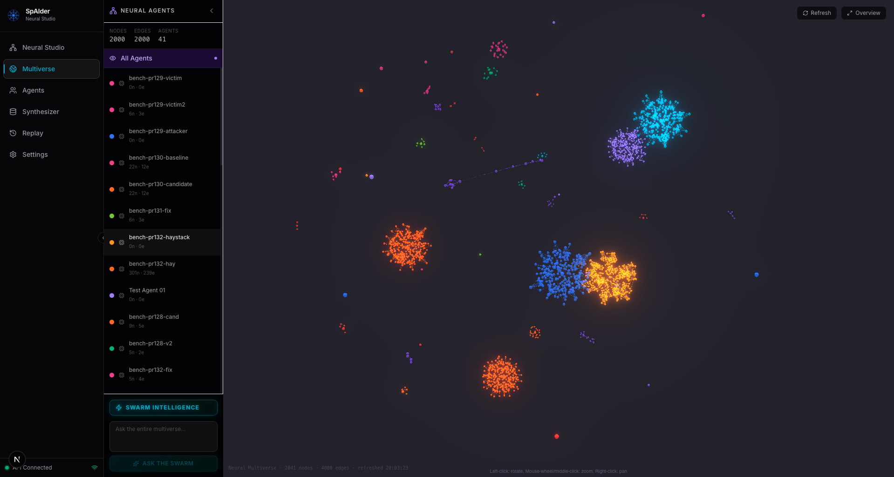

# SpAIder

<p align="center">
  <a href="https://github.com/Spaider-studio/spaider/actions/workflows/ci.yml"></a>
  
  
</p>

<p align="center">
  
</p>

**Long-term memory for AI agents.** Your agents remember across sessions, and every answer cites where it came from. Open source, self-hosted, and works with any MCP client.

## Why SpAIder

- **It remembers what matters.** Text becomes a knowledge graph. Duplicates merge and outdated facts retire, with their history kept.
- **Answers show their sources.** Every claim links back to the fact it came from.
- **Fast when it has to be.** Writing and recalling take about 20 ms at 100,000 nodes with no LLM call, quick enough for robots.
- **It learns from use.** Feedback and a nightly sleep cycle consolidate memory and improve what gets recalled.
- **It stays yours.** Roles, clearance levels and approved sharing between knowledge bases. Run it fully local with Ollama.

## Quickstart

You need Docker and Python 3.11 or later.

```bash
git clone https://github.com/Spaider-studio/spaider.git && cd spaider
python3 -m venv .venv && source .venv/bin/activate
pip install -e ./cli
spaider init
```

`spaider init` asks for your LLM provider (OpenAI, Anthropic or local Ollama), starts the stack, creates your first knowledge base and connects Claude Code. Then try it:

```bash
spaider ingest "Priya Nair is the CEO of Zephyr Robotics."
spaider query "Who runs Zephyr Robotics?"
```

Something off? Run `spaider doctor`. For other setups, see [installation](docs/installation.md).

## Connect your agent

```bash
spaider mcp add cursor
```

Works with `claude-code`, `claude-desktop`, `cursor`, `windsurf`, `vscode`, `zed`, `opencode` and `codex`. Each client gets its own key, so you can revoke one without touching the others.

## What you get

| | |
|---|---|
| **Memory** | Knowledge graph, fast episodes, sleep cycle. [How it works](docs/architecture.md) |
| **Studio** | Browse the graph, manage members and sharing at `localhost:3000` |
| **Clients** | [Python](sdk/python/README.md), [TypeScript](sdk/typescript/README.md), [REST](docs/api.md), MCP and the [CLI](cli/README.md) |
| **Robotics** | On-device memory with [spaider-edge](sdk/edge/README.md) and a [ROS 2 bridge](sdk/ros2/README.md) (tested with simulated ROS 2 only) |
| **Fine-tuning** | Train on your own knowledge through OpenAI, Together or Tinker. [Details](docs/finetuning-export.md) |

## Benchmarks

On private data a model can't already know (16 questions), `gpt-4o-mini` alone scores **0.00**. With SpAIder it scores **0.96** (95% CI 0.89 to 1.00, judged by `gpt-4o`, measured on 0.5.0). That is the value of memory in general: in earlier head-to-head tests, Mem0 and Cognee came out statistically tied with SpAIder.

Methods and full results: [benchmarks](docs/benchmarks.md).

## More

[All documentation](docs/README.md) · [Upgrading to 0.5](docs/migrating-to-0.5.md) · [Contributing](CONTRIBUTING.md) · [Security](SECURITY.md)

Backend and Studio are AGPL-3.0, with a [commercial license](docs/licensing.md) available. The CLI and SDKs are Apache-2.0.
