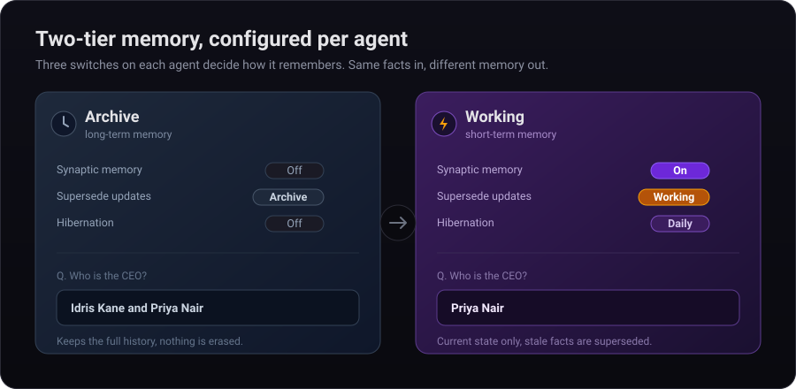

# Architecture


```
                          ┌─────────────────────────────────────────┐
                          │              Kong Gateway :8080          │
                          │   rate-limiting · CORS · routing         │
                          └────────────────┬────────────────────────┘
                                           │
                          ┌────────────────▼────────────────────────┐
                          │           FastAPI Backend :8000          │
                          │  /ingest  /query  /graph  /synthesize   │
                          │  /agents  /connectors  /swarm           │
                          └──┬───────────────┬──────────────┬───────┘
                             │               │              │
               ┌─────────────▼──┐   ┌────────▼──────┐  ┌───▼────────┐
               │  Kafka :9092   │   │  Neo4j :7687  │  │ Redis :6379│
               │  spaider.ingest│   │  Graph Store  │  │  Cache /   │
               │  .raw topic    │   │  + APOC + FTS │  │  Sessions  │
               └────────┬───────┘   └───────────────┘  └────────────┘
                        │
               ┌────────▼───────────────────┐   ┌─────────────────────────────┐
               │  backend-worker (x N)       │   │  PostgreSQL :5432           │
               │  SemanticCompressor (LLM)   │   │  Connector state +          │
               │  EntityResolver (embeddings)│   │  credentials (AES-256-GCM)  │
               │  ConnectorScheduler         │   └─────────────────────────────┘
               └─────────────────────────────┘   ┌─────────────────────────────┐
                                                  │  Next.js Frontend :3000     │
                                                  │  3D Force Graph (WebGL)     │
                                                  └─────────────────────────────┘
```

ClickHouse (:8123) stores analytics and audit logs. See [docs/operations.md](operations.md) for the full service table and scaling.

## Memory tiers: how each agent remembers

Human memory isn't one thing. A working memory keeps the current state and lets go of what it no longer needs; a long-term memory preserves the record. SpAIder gives every agent that same choice, as three independent switches on the agent card.

<p align="center">
  
</p>

| | Synaptic Memory | Supersede updates | Hibernation |
|---|---|---|---|
| **Archive** (long-term) | off | Archive | off |
| **Working** (short-term) | on | Working | daily / hourly |

- **Synaptic Memory** reinforces the facts an agent actually uses and lets unused ones decay (Hebbian weights on the graph edges).
- **Supersede updates** decides what happens on a contradiction. An *archive* agent keeps both "Idris was CEO" and "Priya is CEO", the full history. A *working* agent supersedes the stale fact, so retrieval returns only the current answer.
- **Hibernation** consolidates the graph on a schedule (prune orphans, fuse duplicates), the way sleep consolidates memory.

Same facts in, different memory out: ask *"who is the CEO?"* and the archive agent answers *"Idris Kane and Priya Nair"* while the working agent answers *"Priya Nair."*

Supersession is validated on real data, not just toy cases: on 83 real business facts (mostly events like merges and reviews) it fires **zero** false updates, and on genuine functional updates it takes current-state answers from **0 to 100%** (95% CI excludes 0).
