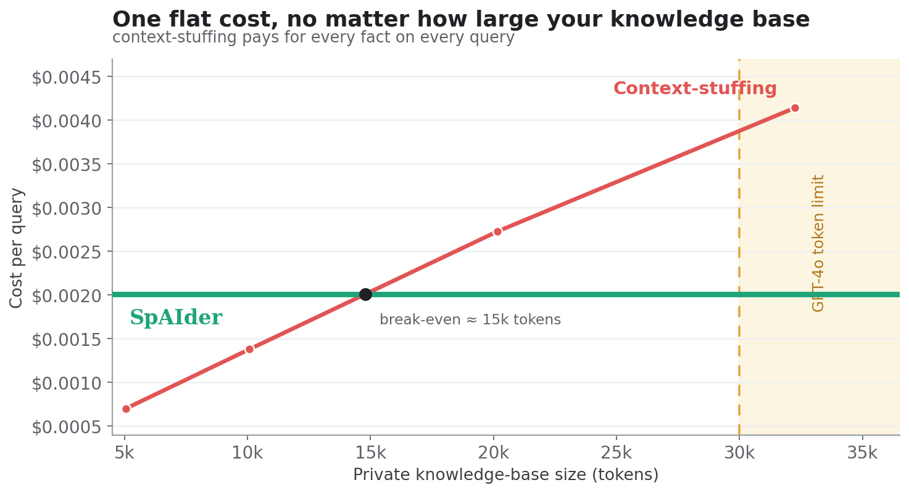

# Benchmarks

> **Re-measured on 0.5.0 (November 2026), private corpus only:** 16 questions, 4 sweeps per arm, independent `gpt-4o` judge. GEval went from 0.00 to 0.96 (95% CI 0.89 to 1.00), F1 to 0.78 and Exact Match to 0.69, all within the intervals published below. See the [full scorecard](../benchmarks/reports/scorecard_acmeai_0.5.md). The public HotpotQA figures, the cost figures and the head-to-head comparison below were measured on earlier versions and have not been rerun.

Benchmarked on **24 HotpotQA** multi-hop questions + a **16-question private corpus**, scored on EM / F1 / GEval (LLM-judge), **8 sweeps**, **95% CIs cluster-bootstrapped over the distinct questions** (not the graded rows), with an **independent gpt-4o judge**.

### Accuracy: the value is the memory, not the model

| Metric | HotpotQA (*public, the LLM memorized it*) | AcmeAI (*private, the LLM can't know it*) |
|--------|---|---|
| **GEval** (gpt-4o judge) | 0.43 → 0.77 (**+0.34**) ✅ | **0.00 → 0.97 (+0.97)** ✅ |
| F1 | 0.09 → 0.70 (**+0.61**) ✅ | 0.00 → 0.78 (**+0.78**) ✅ |
| Exact Match | 0.00 → 0.52 (**+0.52**) ✅ | 0.00 → 0.72 (**+0.72**) ✅ |

*vanilla (gpt-4o-mini alone) → with-SpAIder. ✅ = lift's 95% CI excludes 0.*

Re-validated against the current code (2026-06): across 6 fresh sweeps, F1 and Exact-Match reproduce within their 95% CIs, GEval reproduces for HotpotQA (0.72 [0.65, 0.79]), and AcmeAI GEval is corroborated by its 0.70 exact-match rate (a hard floor for GEval).

On **private data the LLM has never seen**, the bare LLM scores **0.00 on every metric** and SpAIder lifts semantic correctness to **0.97**. That is the entire value of the memory. Even on public trivia the LLM already half-knows, grounding the answer in retrieved facts still lifts it markedly (0.43 → 0.77).

**Head-to-head:** on identical corpora, questions and an independent gpt-4o judge, SpAIder is **statistically tied with Mem0 and Cognee** , every system-vs-system difference falls within its 95% CI , while all three beat a bare model by a wide margin on private data. Full reproducible table (3 corpora, both retrieval-isolated and native modes): [benchmarks/reports/COMPARISON_SYSTEMS.md](../benchmarks/reports/COMPARISON_SYSTEMS.md).

### Cost: flat as your knowledge base grows

Getting from **0.00 to 0.97** means grounding the answer in your data. The brute-force way, pasting your entire knowledge base into every prompt (*context-stuffing*), reaches the same accuracy, but its cost grows with every fact you add and eventually hits a hard wall. SpAIder retrieves only the relevant slice, so it **matches that accuracy at a flat, corpus-independent cost**.

  
   
  <i>Your data can be a library. SpAIder reads only the chapter that matters, and answers like it read everything.</i>

- **SpAIder:** ~flat **$0.002 / query** at any corpus size (it sends a bounded retrieved slice, not the whole corpus).
- **Context-stuffing:** cost climbs linearly, **crosses SpAIder at ~15k tokens** (roughly a 30-page document), and above **~30k tokens** the request is rejected outright by the model's token limits. SpAIder is unaffected.

So on a private knowledge base of any real size, SpAIder is both **more accurate than the model alone** (0.97 vs 0.00) **and cheaper than stuffing the corpus**, and it keeps working where context-stuffing cannot.

→ Full results: **[benchmarks/reports/COMPARISON.md](../benchmarks/reports/COMPARISON.md)** · per-corpus [HotpotQA](../benchmarks/reports/scorecard_hotpotqa.md) / [AcmeAI](../benchmarks/reports/scorecard_acmeai.md) · token economics + methodology: **[docs/token-economics.md](token-economics.md)** · reproduce with `make bench-scorecard`.

### Continual learning: does it forget?

Memory systems are sold on ingest and recall, but nobody reports what happens to *earlier* knowledge as *new* knowledge arrives. SpAIder ships a reproducible **continual-learning benchmark** that measures exactly that: ingest a task, then re-probe earlier tasks to quantify **forgetting** (accuracy lost on old knowledge) and **knowledge transfer** (whether earlier learning helps later tasks). To our knowledge, no other memory system publishes this.

On the example sequences (invented private corpora the model cannot know), SpAIder retains **~89% of earlier-task accuracy** after learning new tasks, with **near-zero average forgetting**, and occasionally *positive* backward transfer (later learning reinforcing an earlier fact).

- Run one: `python -m benchmarks.continual.sequence_runner --sequence benchmarks/continual/sequences/example_org_products.yaml`
- A/B the synaptic engine against classic retrieval, per agent: `--memory-mode on|off`
- Results render in the dashboard's **Continual learning** tab (accuracy matrix + forgetting/transfer).

This is a measurement tool, not a leaderboard claim: on the current sequences the synaptic engine and classic retrieval score within noise of each other. The benchmark exists so that as the cognitive layer evolves, any real gain is provable rather than asserted.
